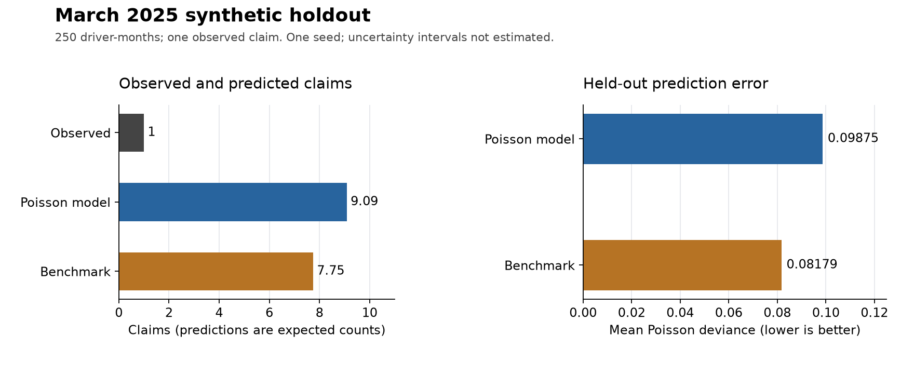

# Results and limitations

The six controlled telemetry scenarios pass their fixed expectations. The separate
claim-frequency model does **not** beat the constant-rate benchmark on the default
held-out month: both overpredict its single observed claim. This is evidence of a
working demonstration, not evidence of real-world accident or pricing accuracy.

Results below were regenerated on **31 October 2026**, using the repository's
default configurations. The [saved results](evidence/results-2026-10-31.json)
include unrounded metrics, settings, runtime versions, source commit and source
hashes. Generated population and trace files remain ignored local outputs.

## Controlled telemetry results

Each scenario has 180 samples at 1 Hz. These are fixed profiles without random
measurement noise; all unlisted event counts and speeding seconds are zero.

| Scenario | Fixed expectation | Observed result | Check |
|---|---|---|---|
| Steady | No events or speeding | No events or speeding | Pass |
| Braking | One harsh braking event | One harsh braking event | Pass |
| Acceleration | One harsh acceleration event | One harsh acceleration event | Pass |
| Cornering | One harsh cornering event | One harsh cornering event | Pass |
| Speeding | 29 speeding seconds | 29 speeding seconds | Pass |
| GPS dropout | No events or speeding across missing readings | No events or speeding | Pass |

The dropout trace retains five invalid GPS samples: valid exposure is 175 seconds,
or 97.22% of its 180 samples. Other scenarios have 180 valid seconds. This confirms
the expected outcome for this particular gap; it does not measure performance
across all possible dropout patterns. Detector unit tests cover noise and boundary
cases separately. See [demo details](telemetry_demo.md) and
[detector assumptions](telemetry_assumptions.md).

## Held-out claim-frequency results

The population pipeline simulates trip summaries directly. It does **not** use
the telemetry detector above, so these model results do not validate a complete
journey-to-claim prediction system.

The default seed `20260803` generates 250 drivers over January–March 2025:
13,673 trips, 750 driver-month exposure rows and 10 claims in total. Each modelling
row uses the **previous calendar month's** speeding-time fraction, harsh brakes
per 100 km and night-driving fraction to predict the target month's claim count.

| Split | Target month | Behaviour month | Rows | Claims | Exposure (policy-years) |
|---|---|---|---:|---:|---:|
| Training | February 2025 | January 2025 | 250 | 7 | 19.1650 |
| Held out | March 2025 | February 2025 | 250 | 1 | 21.2183 |

January's 250 target rows are excluded because December behaviour is unavailable.
The same 250 drivers appear in training and evaluation. This tests a later month
for known drivers, not generalisation to unseen drivers. Zero-claim rows are
retained: 249 of the 250 held-out rows have no claims.

The Poisson model accounts for insured exposure. Its benchmark uses the training
claims divided by training exposure: **0.36525 claims per policy-year**, applied
to each held-out row's exposure. Neither method is fitted to March outcomes.

| Held-out measure | Poisson model | Constant-rate benchmark |
|---|---:|---:|
| Observed claims | 1 | 1 |
| Predicted claims | 9.0905 | 7.7500 |
| Observed annual claim rate | 0.04713 | 0.04713 |
| Predicted annual claim rate | 0.42843 | 0.36525 |
| Observed / predicted claims | 0.1100 | 0.1290 |
| Mean Poisson deviance (lower is better) | 0.09875 | 0.08179 |



Fractional predicted claims are expected counts, not individual claim decisions.
Annual rates divide claims by exposure-years; they are not probabilities or
percentages. An observed/predicted ratio of 1 would mean aggregate agreement.
Poisson deviance measures count-prediction error and is averaged over the 250
held-out driver-months. It is not a classification accuracy score.

The benchmark has lower error on this run. Both methods substantially overpredict
the observed total. Seven training claims and one held-out claim are insufficient
to establish stable model quality or a statistically reliable ranking between
methods. No confidence intervals or multi-seed estimates were produced.

### Calibration by predicted risk

Drivers are split into approximately equal thirds using the model's predicted
annual rate. Group 1 has the lowest predicted rate; group 3 has the highest.

| Group | Driver-months | Exposure (policy-years) | Observed claims | Predicted claims | Observed annual rate | Predicted annual rate |
|---|---:|---:|---:|---:|---:|---:|
| 1 | 84 | 7.1294 | 0 | 0.8154 | 0.0000 | 0.1144 |
| 2 | 83 | 7.0445 | 1 | 1.5467 | 0.1420 | 0.2196 |
| 3 | 83 | 7.0445 | 0 | 6.7285 | 0.0000 | 0.9551 |

The only observed claim falls in the middle group. This sample does not establish
useful risk separation or calibration. Zero observed claims in a group do not
establish that its drivers are safe or have zero underlying claim risk.

## Limits of the evidence

- **Synthetic assumptions:** claim-generation rules deliberately relate driving
  features and hidden traits to claim frequency. Fitting this generator cannot
  establish that those relationships hold for real drivers or claims. The
  generator uses current-month behaviour, while the model uses previous-month
  behaviour; the model is not recovering the generator's exact formula.
- **Sampling:** the default population spans three months and only ten claims.
  The usable training period is one month. One seed, one time split and shared
  drivers cannot establish performance across populations, unseen drivers or
  changing conditions. The evaluated three-feature model also omits other
  factors used by the generator.
- **Sensor resolution:** 1 Hz sampling can miss brief manoeuvres; smoothing can
  reduce peaks. GPS gaps remove evidence. The detector does not infer events
  through a gap. Thresholds and the speeding tolerance are engineering choices,
  not validated safety boundaries or legal allowances.
- **Coverage:** six fixed scenario checks are not estimates of real-world
  detector precision or recall. No external journey or claims dataset was used.
  No-event journeys are not certified safe.
- **System boundary:** the API provides health and documentation routes only.
  Claim severity modelling, premiums, fairness, uncertainty estimation and
  deployment monitoring are outside the completed demonstration.

Larger samples across seeds and held-out drivers would be useful future checks,
but would still require compatible real observations before any real-world
performance claim. These remain [optional extensions](scope.md).

## Reproduce and inspect

From the repository root, with the project installed and its environment active:

```bash
python -m apexrisk telemetry-demo
make pipeline
python -m apexrisk.models.frequency
python -m apexrisk.models.evaluation
```

The pipeline and demo replace their named generated outputs. The model commands
read `data/generated/`, so rerun the pipeline before evaluating older local data.
These results were collected in a separate temporary output directory, preserving
existing local data. Model inputs and exposure were checked for unique driver-month
keys and previous-month alignment. Predictions were checked against the model's
log-link calculation; mean deviance was independently checked with statsmodels'
Poisson-family deviance divided by the held-out row count.

The saved run used Python 3.14.8, NumPy 2.5.3, pandas 3.0.5, statsmodels 0.15.0
and PyArrow 23.0.1. Dependency ranges and the Docker base tag are not fully locked;
different environments or future rebuilds may change values. Treat the evidence
as a dated snapshot and retain versions when comparing new runs.

## Docker verification

The image build succeeded in the user's terminal. A subsequent check of that
`apexrisk:local` image on 31 October 2026 confirmed HTTP 200 from `/health` with
the expected synthetic-mode response, HTTP 200 and Swagger UI HTML from `/docs`,
and an OpenAPI schema containing `/health`. The telemetry demo passed all six
scenarios inside the image. The temporary API container was stopped successfully.
This checks the docs route and HTML; browser rendering was not independently
checked. See [container evidence](evidence/docker-2026-10-31.json).

To repeat the interactive check, build and start the API:

```bash
docker build -t apexrisk:local .
docker run --rm --name apexrisk-api -p 127.0.0.1:8001:8000 apexrisk:local
```

In another terminal:

```bash
curl --fail http://localhost:8001/health
curl --fail http://localhost:8001/docs
docker stop apexrisk-api
docker run --rm apexrisk:local python -m apexrisk telemetry-demo
```

Open `http://localhost:8001/docs` in a browser while the API is running to inspect
the interactive documentation. This verifies packaging and the present API
surface, not a deployed scoring service. The model metrics above were collected
in the local environment, separately from these container checks.
